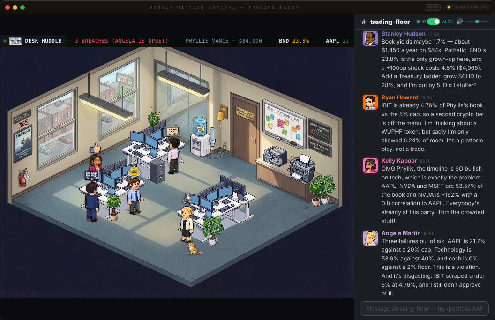
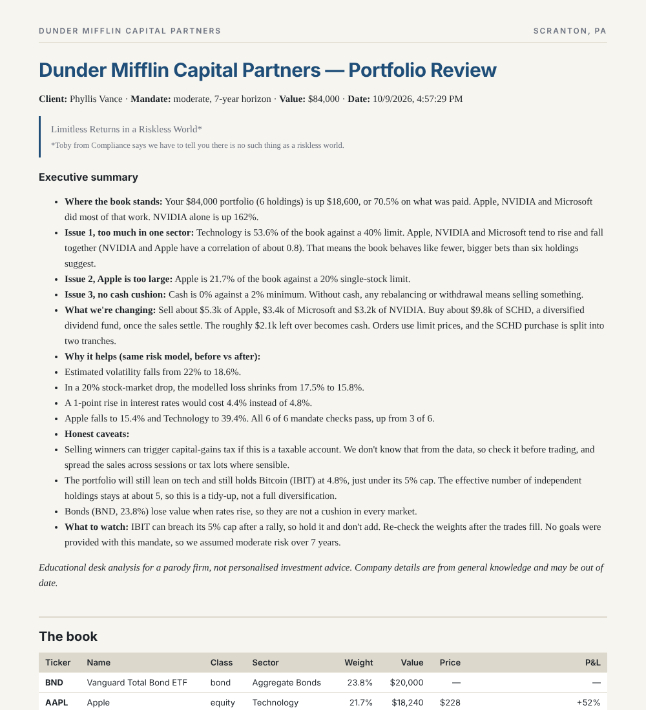
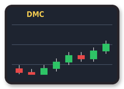
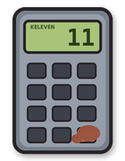
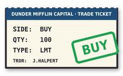
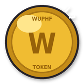
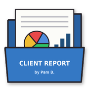
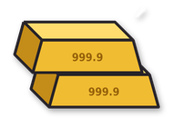
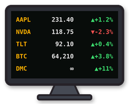
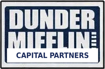

# Claude Office — Dunder Mifflin Capital edition

A pixel art virtual office that visualizes your AI agents working in real-time. Watch Claude Code agents spawn, sit at desks, take coffee breaks, and chat in a Slack-inspired office chat panel — all rendered in an isometric pixel art office.

## Dunder Mifflin Capital — the trading firm

The Scranton branch stopped selling paper. **Dunder Mifflin Capital Partners** is now a boutique trading firm, and every employee is an AI agent with a real job on the desk. Give them a portfolio and the whole office goes to work on it, in character.

<p align="center"></p>

### Send the desk a book

Type into the `#trading-floor` chat:

```
/portfolio AAPL 30%, MSFT 20%, NVDA 15%, TLT 15%, GLD 10%, BTC 5%, CASH 5% | moderate, 5y, $250k, name: Bob Vance
/portfolio NVDA 120sh @118 cost 45, AAPL 80sh @228 cost 150, SCHD $15k, BND $20k, IBIT $4k | moderate, 7y, name: Phyllis Vance
```

Positions can be weights (`AAPL 30%`), shares with price and cost (`NVDA 120sh @118 cost 45`), or dollar amounts (`VOO $20k`). After the `|` you can add a risk profile (conservative / moderate / aggressive), a horizon, an account size and a client name. Type `/portfolio` on its own for help.

**What happens next**

1. 📞 **Erin** logs the order, and **Michael** calls everyone into the conference room.
2. 🧮 **Kevin** runs the numbers: value, weights, P&L vs cost, concentration. The calculator does the math, so the numbers are right.
3. 🐻 **Dwight** (risk), 📊 **Oscar** (research), 🥨 **Stanley** (income & rates), 💅 **Kelly** (sentiment), 🪙 **Ryan** (crypto & alts) and 🐈 **Angela** (mandate compliance) walk in, sit at desks and work the book in parallel. **Meredith** joins if you hold commodities, and **Carol** joins if you hold REITs. Each one is a separate `claude -p` agent with their own persona and job.
4. ☕ **Desk huddle**: the characters argue about each other's findings in the chat. Dwight vs Ryan, Oscar correcting Michael, Angela vetoing, Toby getting shut down.
5. 🎯 **Jim** turns it into a trade list. If his allocation breaks the mandate, Angela rejects it and the desk uses a compliant baseline instead.
6. 🎨 **Pam** writes the client report. 📎 **Toby** adds the disclosure. **Michael** signs off.

The report opens from the chat link or the 📄 button on the ticker tape (`http://127.0.0.1:3334/reports/<id>`). It covers an executive summary, positions, each department's analysis, the huddle transcript, the trade list, a **before vs after** risk table, and the disclosures. Markdown and JSON copies live in `reports/<id>/`.

<p align="center"></p>

### Talk to the characters

Ordinary chat messages are routed by name or by topic (`scripts/desk-router.py`). Each character answers in voice, using the numbers from the latest book:

- "**Dwight**, what's our biggest risk?" → Dwight
- "should we buy more bitcoin?" → Ryan
- "what happens if the Fed cuts rates?" → Stanley
- "are we ESG compliant?" → Nellie

About a third of the time a rival chimes in (Jim after Dwight, Angela after Kevin, Dwight after Ryan…). Set `DESK_CHIME_CHANCE=0` to turn that off. Dev questions (bugs, PRs, CSS) still go to the original Claude Office agents.

### The org chart — old departments, new jobs

| New department | Formerly | Who |
|---|---|---|
| **Managing Partner's Office** | Regional Management | 👔 Michael Scott — Managing Partner |
| **Sales & Trading Desk** | Sales | 🎯 Jim Halpert — Head of Execution Trading<br>🥨 Stanley Hudson — Fixed Income & Dividend Strategist<br>🎶 Andy Bernard — Client Coverage & Capital Introductions<br>🧶 Phyllis Vance — Private Wealth Advisor |
| **Risk Management** | Assistant (to the) Regional Manager | 🐻 Dwight Schrute — Chief Risk Officer (Assistant to the Managing Partner) |
| **Quant & Fundamental Research** | Accounting | 📊 Oscar Martinez — Head of Quant & Fundamental Research<br>🔎 Karen Filippelli — Equity Research Analyst (Stamford Transfer) |
| **Fund Accounting & Controllers** | Accounting | 🐈 Angela Martin — Fund Controller & Mandate Compliance<br>🧮 Kevin Malone — P&L & Position Reconciliation |
| **Compliance & Regulatory** | Human Resources | 📎 Toby Flenderson — Chief Compliance Officer<br>🦉 Holly Flax — Conduct, Training & Culture |
| **Client Reporting & Investor Relations** | Reception | 🎨 Pam Beesly — Head of Client Reporting & Investor Relations<br>📞 Erin Hannon — Trade Desk Coordinator (Order Intake) |
| **Market Intelligence** | Customer Service | 💅 Kelly Kapoor — Market Sentiment & Social Media Analyst |
| **Digital Assets & Alternatives** | Temp / Quality Assurance | 🪙 Ryan Howard — Head of Digital Assets & Algorithmic Strategies<br>🕶️ Creed Bratton — Special Situations & Due Diligence |
| **Commodities & Real Assets** | Supplier Relations / Real Estate | 🛢️ Meredith Palmer — Commodities Trader<br>🏠 Carol Stills — REITs & Real Assets Analyst |
| **Trade Operations & Settlement** | Warehouse | 🎹 Darryl Philbin — Head of Trade Operations & Settlement<br>📦 Roy Anderson — Settlement Clerk |
| **Investment Committee (Corporate)** | Corporate | 🕯️ Jan Levinson — Head of Institutional Strategy & Macro<br>🏛️ David Wallace — Chairman & CEO<br>🦎 Robert California — Chief Investment Officer<br>🖥️ Gabe Lewis — Electronic Trading Systems (Sabre Integration)<br>🌿 Nellie Bertram — Special Projects: ESG & Thematic Investing |
| **Limited Partners** | Clients & Vendors | 🧊 Bob Vance — Anchor LP — Bob Vance, Vance Refrigeration |

Michael (Managing Partner) is **you**, the boss. Jim, the assistant, runs execution. The single source of truth for everyone is [`firm/roster.json`](firm/roster.json). Edit a title, voice, duty or keywords there and the desk, chat router, subagents and UI all pick it up.

### Props

Every cast member gets a signature prop above their desk. The originals are still here (World's Best Boss mug, Dundie, Schrute Buck, jello stapler, pretzel, Serenity by Jan, Finer Things Club, Angela's cats), plus new trading props drawn by `scripts/generate-trading-props.py`:

<p align="center">
  
  
  
  
  
  
  
  
  
  
  
  
</p>

A scrolling **ticker tape** across the top of the floor shows the book on the desk: holdings, P&L or 1-year return, vol, VaR, and whether Angela is upset.

### The Scranton floor map

With the trading-floor theme on (the default), the office is the whole Dunder Mifflin Scranton floor. It's rebuilt tile by tile in the original Claude Office style: cream walls with dark outlines, slate carpet, and the original standing desks, plants, filing cabinets, printer, coffee machine and whiteboard. Every room is there: the elevators, the waiting area, reception, Michael's glass office, the conference room, the bullpen, accounting, the supply closet, the copy alcove, the red-carpet stairs to the warehouse, the break room (vending machines, Finer Things Club), the kitchen, the restrooms, the annex and Ryan's closet.

Every wall and piece of furniture is its own layer, so people walk behind desks and low walls and in front of them, and you can see them through Michael's glass.

**Camera (Zillow-style).** The angle is fixed. You see one part of the office close up and move between parts:

| Control | What it does |
|---|---|
| ‹ › ˄ ˅ edge arrows | Slide to the next part of the office |
| Drag the floor | Pan freely |
| Minimap (top right) | Click anywhere to jump there; the yellow box is what you're looking at |
| **Go to…** menu | Jump straight to a room |
| − / + or the mouse wheel | Zoom from the whole floor ("All") down to a close-up |

**Driving Michael.**

| Control | What it does |
|---|---|
| D-pad (bottom right) | Walk along the floor's axes (↖ ↗ ↘ ↙). Hold to keep walking |
| Arrow keys / WASD | Walk (up+right = ↗, etc.). Ignored while you're typing in chat |
| Click the floor | Michael walks to that spot and waits there |
| Drag Michael | Pick him up and carry him (the camera slides when you reach an edge), then drop him. He lands on the nearest floor spot, or sits down if you drop him on a free chair or the couch. Drop him on his own chair and he's back at work. |
| Michael's face | Camera follows him again |
| 🏠 Desk | He walks back to his desk |

Walls, desks and furniture block him; he slides along them instead of walking through. Everyone else finds their way with A* pathfinding on the same walk grid.

**Nameplates.** Everyone has a nameplate under their feet in their colour; zoom in further and it adds their job title. Nameplates sit on their own top layer, so desks and walls never hide them, and they hide in the zoomed-out overview.

**The office clock** (title bar). The office has its own date and time. It runs in real time but only moves forward:

- **+2h** jumps two hours ahead.
- **⏭ Skip to…** picks any later date and time, with shortcuts for *Next 9 AM*, *Next market open (Mon–Fri 9:30)* and *Next 5 PM*. Earlier times are refused.

The server keeps the clock (in `~/.agent-office/clock.json`), so reloading the page or restarting the office can't rewind it. Every jump is noted in chat. The day/night lighting follows the office clock, using Scranton's sunrise and sunset, and so do chat timestamps. The AUTO/DAY/NIGHT button still overrides the lighting. To reset the clock to real time, stop the office and delete `~/.agent-office/clock.json`.

**Sitting.** People sit at desks, in the conference rows, at the kitchen, break-room and annex tables, on the waiting couch and in Michael's guest chairs. A chair back facing the camera is drawn in front of the person, so you see head and shoulders over it; behind a desk, they're hidden at the waist. Standing spots stay standing: the front of the conference room, the walls during a packed meeting, the coffee machine, water coolers, copier, filing cabinet and warehouse stairs.

**Live market data (Alpha Vantage).** Put your key in `firm/desk.secrets.json`:

```json
{ "alphaVantageKey": "YOUR_KEY" }
```

That file is git-ignored, so your key never goes to GitHub. You can also set `ALPHAVANTAGE_API_KEY` instead. `firm/desk.secrets.example.json` shows the format.

- Live quotes come from Alpha Vantage: price, today's change, the day's range and volume, plus Bitcoin and Ethereum via its currency endpoint.
- A year of daily history comes from Yahoo, with Alpha Vantage's 100-day history as the backup.
- The free plan allows about 25 calls a day, so everything is cached in `~/.agent-office/av-cache.json`, which survives restarts. Quotes are cached for 5 minutes while the market is open and 1 hour when it's closed, history for 12 hours.
- If Alpha Vantage says the daily limit is used up, the office stops asking until tomorrow and falls back to Yahoo or model estimates.
- Type `/market` to see whether the market is open and how many Alpha Vantage calls you've used today.

**The opening bell.** The office follows NYSE hours (9:30–16:00 New York time, Monday–Friday, NYSE holidays off) on the office clock. At the opening bell, Michael rings it, everyone is called onto the floor, and everyone goes to their desk (desk-sharers find a shared spot). Staff called in at the bell stay until you dismiss them. If you open the office during market hours, the same happens a few seconds after it loads. Skipping the clock to a market open (+2h, or *Skip to… Next market open*) rings the bell too. The closing bell is just an announcement.

**Ask the group chat.** Ask anything in #trading-floor and the people whose field it is answer, in character. "How is apple doing today" gets Oscar on price and trend, Kelly on sentiment and Dwight on risk. "What's the Fed going to do" gets Jan. "Is it a good time to buy bitcoin" gets Ryan.

- Name someone ("Dwight, how risky is TSLA?") and they answer.
- Company names, tickers and `$TICKER` are recognised, and the live quote is handed to whoever answers.
- Answers come from the Claude Code CLI when `"llm": "claude"` is set, otherwise from built-in lines.
- The **AI On/Off** switch in the chat header turns staff answers on and off.

**Click to talk.** Click anyone on the floor and Michael walks over and starts a conversation with them: the same walk-up conversation as below, without having to walk there yourself.

**All-hands briefing.** Type `/briefing AAPL` (optionally add a question, e.g. `/briefing NVDA is this too crowded?`). Michael calls everyone into the conference room and Jim runs the room. The other 25 each give one take from their own job's angle, with a speech bubble and a 🟢/⚪/🔴 stance in chat. They go branch by branch:

| Branch | Who |
|---|---|
| Trading & Risk | Dwight, Stanley, Phyllis, Andy |
| Research & Quant | Oscar, Karen |
| Compliance & Finance | Angela, Kevin, Toby, Holly |
| Operations & Technology | Darryl, Roy, Gabe, Erin, Pam |
| Market Intelligence | Kelly, Ryan, Creed, Meredith, Carol, Nellie |
| Investment Committee | David Wallace, Robert California, Jan, Bob Vance |

Jim wraps up with the tally and the desk view. Pam posts a report with every take, a note per person and the numbers (it shows up under `/reports`), then the meeting breaks up.

- With market data on, the takes use one year of daily prices: last price, 1-year and 3-month returns, volatility, drawdown, beta vs SPY, distance from the 52-week high and the 200-day trend. Otherwise they work from model estimates.
- With `"llm": "claude"`, every take is written by Claude in character (one call per branch, started up front). Otherwise built-in lines are used.
- Walk-up greetings pause while a meeting is on. In a packed room, only the person speaking shows a nameplate.

**Walk-up conversations.** Walk, click or drop Michael next to someone and stop there. They greet you in character, or tell you what they're in the middle of, with a speech bubble over their head and the line in chat. A *Talking with Dwight Schrute* chip appears above the chat box, and until you walk away, whatever you type goes to them. They answer as that character, in chat and in a bubble.

- If you ask about the book, they answer from the latest portfolio on the desk.
- Replies come from the Claude Code CLI when `"llm": "claude"` is set in `firm/desk.config.json`. Otherwise built-in lines in each character's voice are used.
- Walking more than a few steps away, leaving the room or clicking × ends the conversation.
- People don't greet you again for 90 seconds, and walking past doesn't count; Michael has to stop.

**Who looks where.** Whoever Michael is talking to faces him, and he faces them. Everyone else in the room glances up at him now and then for a few seconds, then goes back to work; when he leaves the room they all go back to their screens. People talking to each other in chat turn to face each other when they're nearby. Otherwise everyone faces their screen.

- **Everyone sits at their own desk.** Pam is at reception. Jim and Dwight face each other, and so do Stanley and Phyllis. Andy and Nellie are next, with Meredith and Creed in the back row. Kevin, Angela and Oscar are in accounting. Kelly, Toby, Gabe and Ryan (in his closet) are in the annex, and Darryl and Roy are at the warehouse stairs.
- **People who share a desk take turns.** Pam and Erin share reception, Toby and Holly share the HR desk, and Andy and Karen share a sales desk. Whoever arrives first sits down. The other floats around the waiting area, the kitchen, the break room, the annex table or Michael's guest chairs. Visitors (David Wallace, Jan, Robert California, Bob Vance, Carol) float the same way.
- **The call bar** (bottom left):

  | Button | What happens |
  |---|---|
  | 📞 **Call Staff** | Opens the directory. Call one person onto the floor, or send them home. |
  | 📢 **Meeting** | All-staff meeting. Everyone walks into the conference room, Michael takes the front, and the rest fill the four rows of chairs and stand along the walls. |
  | 🗂 **Planning ▾** | Pick a segment (Risk, Research, Fund Accounting…). Only that team and Michael go into the conference room. |
  | 🪑 **Go to desk** | Ends any meeting and sends everyone to their own desk. On a shared desk, whoever is sitting there keeps it; otherwise the first owner gets it (Pam before Erin). The other sharer and any visitors go to a shared spot: the kitchen, break room, waiting area, annex table or Michael's guest chairs. Michael stays where you put him. |
  | 🏠 **Dismiss** | Ends any meeting and sends everyone home through the elevators. |

  From chat you can also use `/meeting [topic]` and `/meeting end`. The `/portfolio` desk huddle happens in the conference room too.
- **Changing the map:** the whole layout (rooms, walls, doors, desks, seats, props) lives in `scripts/build-scranton-iso.py`. Edit it, then run `python3 scripts/build-scranton-iso.py --preview`. That redraws the floor (day and night), the furniture atlas, the minimap and the walk grid into `public/rooms/` and `firm/scranton-floor.json`, and writes a full picture to `docs/reference/scranton-iso-preview.png`. Restart Vite afterwards so it serves the new images.
- Want the old single room back? Open `http://localhost:3333/?classic`.

### Use them from Claude Code

`.claude/agents/` has a subagent for every employee (`risk-manager`, `quant-researcher`, `income-strategist`, `execution-trader`, `fund-controller`…), generated from the roster by `scripts/generate-subagents.py`. In Claude Code, say "use the risk-manager agent to stress-test this portfolio". With the hooks installed, Dwight walks into the office while he works.

You can also start a review over HTTP:

```bash
curl -s -X POST http://127.0.0.1:3334/portfolio -H 'Content-Type: application/json' \
  -d '{"text": "AAPL 40%, MSFT 30%, TLT 30% | conservative, name: Jan"}'
```

### Desk settings — `firm/desk.config.json`

| Setting | Default | What it does |
|---|---|---|
| `llm` | `"claude"` | `"claude"` uses the Claude Code CLI for every agent. `"offline"` uses templates (fast, free, less funny). The desk also falls back to templates on its own if the CLI is missing or a call fails. |
| `model` | `""` | Passed to `claude --model` (e.g. `"sonnet"`). |
| `liveResearch` | `false` | Lets analysts use WebSearch/WebFetch for current news and data. This is slower and uses more tokens. |
| `marketData` | `"yahoo"` | Pulls 1 year of daily prices (best-effort, unofficial Yahoo endpoint) for real vol, correlation, beta and drawdown, and fills in missing prices. `"off"` uses model estimates. |
| `concurrency` | `3` | How many analysts work at once. |
| `paceMs` | `2200` | Gap between chat lines, so you can read along. |

Commands: `/portfolio`, `/meeting [topic]` / `/meeting end`, `/desk` (status), `/roster` (who does what), `/reports` (recent reports), `/the-office` or `/trading-floor` (toggle the theme; it's on by default).

> **Disclaimer (Toby insisted):** the desk is a parody. Its analysis is educational and is not investment, tax or legal advice. The numbers come from your inputs plus simple models or public price data. Check everything with a licensed professional before trading.

### The cast
<p align="center">
  
  
  
  
  
  
  
  
  
  
  
  
  
  
</p>

---

### Full office — agents working, chatting, and taking coffee breaks


## Features

**Live Agent Visualization**
- Agents appear as pixel art characters that walk into the office through the door
- Each agent type gets a unique character sprite and desk assignment
- Agents show typing bubbles, take coffee/water breaks, and leave when done
- Boss character (you) with Red Bull, Claude with coffee
- Random office events: pizza deliveries, fire drills, power flickers, printer jams
- Day/night cycle with smooth transitions

**AI-Powered Office Chat**
- Back-and-forth conversation with Claude through the office chat panel
- Claude has a witty office manager personality with running jokes
- Multi-agent routing — mention a bug and the Debugger responds, ask about UI and Frontend answers
- Typing indicators, emoji reactions, read receipts
- Slash commands: `/status`, `/agents`, `/help`
- Chat history persists across restarts (SQLite)
- Proactive messages — agents announce when they start and finish work
- Smart macOS notifications for important events

**Context-Aware AI**
- Claude knows your current git branch and active agents
- Conversation memory — remembers the last 10 messages
- AI On/Off toggle to control token usage

### Night mode — the office after dark, agents still grinding


### Waiting for tokens... the office keeps itself entertained


## How It Works

Claude Code hooks capture agent spawns, tool calls, and completions via `PreToolUse` and `PostToolUse` hooks. Events are sent to a local Express + WebSocket server, which broadcasts them to the React frontend.

```
Claude Code ──hook──> Express Server ──WebSocket──> React Frontend
                           │
                     SQLite (chat)
                           │
                   Chat AI Watcher ──claude -p──> Reply
```

## Quick Start

```bash
# Clone
git clone https://github.com/W17ant/Claude-Office.git
cd Claude-Office

# Install
npm install

# Start everything (server + frontend + chat watcher)
bash scripts/start-office.sh

# Stop everything
bash scripts/stop-office.sh
```

Open `http://localhost:3333` — the office is ready.

### Auto-Permissions

The repo includes `.claude/settings.json` which auto-allows curl commands to the local office server (`127.0.0.1:3334`) and the start/stop scripts. This means the chat monitor cron and office commands run without permission prompts.

### Connect Claude Code

Add the hook to `~/.claude/settings.json`:

```json
{
  "hooks": {
    "PreToolUse": [
      {
        "hooks": [{ "type": "command", "command": "bash /path/to/Claude-Office/hooks/agent-tracker.sh" }]
      }
    ],
    "PostToolUse": [
      {
        "hooks": [{ "type": "command", "command": "bash /path/to/Claude-Office/hooks/agent-tracker.sh" }]
      }
    ]
  }
}
```

Now spawn agents in Claude Code and watch them appear in the office.

## Customise Your Character

The boss character (you) is configurable via `office.config.json`:

```json
{
  "boss": {
    "name": "YourName",
    "sprite": "MyChar-1",
    "color": "#ff4444",
    "emoji": "crown"
  }
}
```

### Creating a custom sprite

Use the Helper sprite sheet as a reference for the 4-direction layout — here's an example of mine next to it:

<p>
  
  
  
</p>

Here's Mini Claude — I asked Claude to describe itself after showing it the office with my avatar, then used the prompt to generate the sprite:


1. Open ChatGPT (with DALL-E image generation)
2. Upload `public/sprites/characters/Helper.png` as a reference
3. Ask it to generate a pixel art character in the same style and layout (4 directions: front-left, rear-right, front-right, rear-left)
4. Save the output and extract the sprites:

```bash
python3 scripts/extract-boss-sprite.py your-character.png MyChar-1
```

## Chat

| Command | Description |
|---------|-------------|
| `/portfolio <holdings> \| <mandate>` | Send a book to the trading desk |
| `/desk` | Trading desk status / last report |
| `/roster` | Who works in which department |
| `/reports` | Links to recent client reports |
| `/status` | Office stats — agents, clients |
| `/agents` | List active agents |
| `/help` | Show available commands |

### Agent Routing

The chat AI routes your messages to specialist agents based on keywords:

| Topic | Agent |
|-------|-------|
| bugs, errors, crashes | Debugger |
| PRs, code review, git | Reviewer |
| UI, CSS, design | Frontend |
| tests, coverage, e2e | Tester |
| auth, security, tokens | Security |
| deploys, Docker, CI | DevOps |
| performance, caching | PerfEng |
| databases, SQL | DBA |
| TypeScript, types | TS Pro |
| AI, LLMs, prompts | AI Eng |
| APIs, REST, webhooks | Fullstack |
| architecture, patterns | Architect |

### Just me and Claude — chatting in the office


## Modes

| URL | Mode |
|-----|------|
| `localhost:3333` | Live — connected to Claude Code via WebSocket |
| `localhost:3333?sim` | Simulation — scripted demo with fake agents |
| `localhost:3333?video` | Video — scripted recording mode |
| `localhost:3333?helper` | Placement helper — dev tool for positioning furniture |

## Tech Stack

- **Frontend**: React + TypeScript + Vite
- **Server**: Express + WebSocket (ws)
- **Storage**: SQLite (better-sqlite3)
- **Chat AI**: Claude CLI (`claude -p`)
- **Sprites**: Custom pixel art (isometric)
- **Desktop**: Electron (optional)

## Project Structure

```
Claude-Office/
├── src/                    # React frontend
│   ├── components/         # Character, SlackChat, FurnitureRenderer
│   ├── hooks/              # useAgentSocket (WebSocket + reconnect)
│   ├── styles/             # office.css, rooms.css
│   └── App.tsx             # Main app (agent lifecycle, events, chat)
├── firm/                   # Dunder Mifflin Capital
│   ├── roster.json         # every employee: department, title, desk duty, voice, keywords
│   └── desk.config.json    # desk settings (LLM, market data, pacing)
├── server/                 # Express + WebSocket server
│   ├── index.js            # HTTP endpoints + WS broadcast
│   ├── chat-db.js          # SQLite wrapper
│   └── desk/               # the trading desk: parser, analytics, prompts, orchestration, report
├── scripts/                # Shell scripts
│   ├── start-office.sh     # Start everything
│   ├── stop-office.sh      # Stop everything
│   ├── chat-ai-watcher.sh  # Polls chat, generates in-character replies
│   ├── desk-router.py      # Routes chat to the right character + builds their prompt
│   ├── generate-subagents.py       # .claude/agents/* from the roster
│   ├── generate-trading-props.py   # draws the trading props
│   └── gather-context.sh   # Git/agent context for prompts
├── hooks/                  # Claude Code hooks
│   └── agent-tracker.sh    # Forwards events to server
├── public/                 # Static assets
│   └── sprites/            # Pixel art characters + effects
└── electron/               # Optional Electron wrapper
```

## Security

- Server binds to `127.0.0.1` only — not exposed to the network
- Event endpoint (`/event`) requires a Bearer token generated at startup
- Chat endpoints are unauthenticated (local single-user design)
- Auth token stored in `~/.agent-office/auth-token` with `0600` permissions

## Desktop App (Electron)

```bash
npm run dev:electron    # Development
npm run build:electron  # Build .dmg
```

## License

MIT
